# MCSP Architecture Guide

An explanation of the Multicloud SaaS Platform (MCSP), written for someone who has never heard of it.

## Contents

- [0. How to read this document (and what it does not prove)](#0-how-to-read-this-document-and-what-it-does-not-prove)
- [1. MCSP in one page](#1-mcsp-in-one-page)
- [2. What MCSP delivers (the end product)](#2-what-mcsp-delivers-the-end-product)
- [3. The big picture](#3-the-big-picture)
- [4. Control Plane vs Data Plane](#4-control-plane-vs-data-plane)
- [5. Cluster inventory](#5-cluster-inventory)
- [6. How multiple clouds work together](#6-how-multiple-clouds-work-together)
- [7. How clusters are linked](#7-how-clusters-are-linked)
- [8. The service lines (products) running on MCSP](#8-the-service-lines-products-running-on-mcsp)
- [9. How a service line or "adapter" uses MCSP](#9-how-a-service-line-or-adapter-uses-mcsp)
- [10. The SRE tooling stack, per service line](#10-the-sre-tooling-stack-per-service-line)
- [11. Telemetry data flows](#11-telemetry-data-flows)
- [12. GitOps: how everything gets deployed](#12-gitops-how-everything-gets-deployed)
- [13. Security and access](#13-security-and-access)
- [14. Environments and promotion](#14-environments-and-promotion)
- [15. How to explain MCSP to a newcomer](#15-how-to-explain-mcsp-to-a-newcomer)
- [16. Open items to verify with the platform team](#16-open-items-to-verify-with-the-platform-team)
- [17. Glossary](#17-glossary)

---

## 0. How to read this document (and what it does not prove)

This document was built by reading the `mcsp-platform-sre-argocd` repository in full: 44 cluster definitions, every ApplicationSet, the Helm charts, the onboarding automation, the CI pipeline and the existing docs. Everything marked **[Repo]** is directly evidenced by a file in that repository.

Some questions asked of this document cannot be answered from this repository alone. This repository is the **SRE tooling layer** of MCSP: monitoring, logging, dashboards and access. It is not the repository that implements the MCSP business services (account management, entitlements, provisioning and so on). The evidence limits are:

| Topic | Evidence level |
|---|---|
| Cluster names, regions, clouds, domains, CP/DP split, service line list | **[Repo]** Verified |
| GitOps flow, Argo CD layout, telemetry flows, auth model | **[Repo]** Verified |
| What the MCSP *business* product does for end customers | **[Context]** General knowledge of the platform. The repo only hints at it (domains `platform.saas.ibm.com`, tenant `sovereigncloud`). Confirm with product owners. |
| The word "adapter" | **Not present anywhere in the repo** (a full-text search returned zero hits). See [section 9](#9-how-a-service-line-or-adapter-uses-mcsp) for the interpretation used here. |
| Sibling repositories (Teleport image, Teleport AWS IaC, `cp-addon-teleport`, `sre-tooling-upgrade-automation`, CI/CD Playbook, Platform SRE runbook) | Their **existence and names** were noted, but their contents were not read because they sit outside the allowed workspace. Links to them are given as pointers, not as verified facts. |
| IBM public documentation | Searched for MCSP definitions and found none in the available IBM doc libraries. |

Anything in this document that is inference rather than evidence is labelled **[Inferred]**. [Section 16](#16-open-items-to-verify-with-the-platform-team) collects everything that needs confirmation.

---

## 1. MCSP in one page

**MCSP** is IBM's **Multicloud SaaS Platform**. **[Context]** It is a shared platform on which many IBM SaaS products run (watsonx, Watson Orchestrate, Db2 on Cloud, MQ, Instana and more). Instead of every product team building its own account system, deployment fabric, observability and operations, they build on one common platform that runs across **IBM Cloud, AWS and Azure**.

MCSP is organised around two kinds of Kubernetes (Red Hat OpenShift) clusters:

| | **Control Plane (CP)** | **Data Plane (DP)** |
|---|---|---|
| Purpose | The "brain": platform-wide management services | The "muscle": where product workloads run for customers |
| Quantity | Few (roughly one per cloud and region group) | Many (one per cloud and region, with extras for geographic expansion) |
| Naming **[Repo]** | `mcsp-cp-…`, `ap-use1-cp-01`, domain `core.<…>.platform.saas.ibm.com` | `mcsp-dp-…`, `ap-use1-dp-01`, domain `<…>.platform.saas.ibm.com` |
| SRE tools **[Repo]** | Minimal: only the platform's own "AutoPlatform" (`ap`) service line | Heavy: up to 30 service lines on a single cluster |

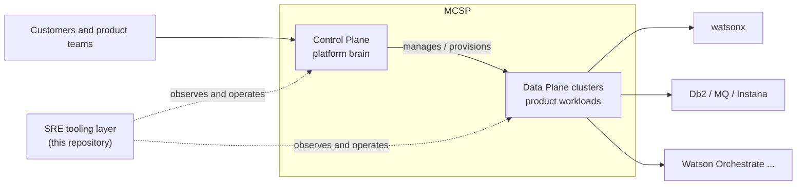

> **[Inferred]** The CP/DP split follows from the naming (`cp` vs `dp`, the `core.` subdomain on CP clusters) and from the end-to-end test harness, which logs in to an "MCSP control plane" and uses it to request new clusters (`CloudRockCluster` custom resources). The functions of the CP and DP clusters are described in general terms in [section 4](#4-control-plane-vs-data-plane).

---

## 2. What MCSP delivers (the end product)

**[Context]** Confirm the business wording with product management.

From the point of view of the three audiences:

| Audience | What MCSP gives them |
|---|---|
| **End customers** | A single place to buy, access and manage IBM SaaS products. Each product is served from a region of the customer's choice (US, EU, Japan, Australia, Brazil, India, UAE and more) on the cloud that hosts it. |
| **Product ("service line") teams** | A ready-made, multi-cloud runtime: clusters, network and security baselines, deployment automation and observability, so they can ship a SaaS offering without building the platform themselves. |
| **SRE / operations** | Uniform, automated monitoring, logging, alerting, remote-access and capacity tooling for every product, in every region, on every cloud. |

What the **repository you are reading** delivers is the third row. It is the automation that gives every product on MCSP, in every cluster, the same operational toolkit:

- **Metrics:** Prometheus plus Thanos for long-term storage
- **Logs:** Loki
- **Dashboards:** Grafana
- **Alerting:** Alertmanager
- **Synthetic monitoring:** Instana Synthetic PoP
- **Capacity optimisation:** Turbonomic
- **Secure admin access:** Teleport-based bastion
- **Config hot-reload:** Reloader

---

## 3. The big picture

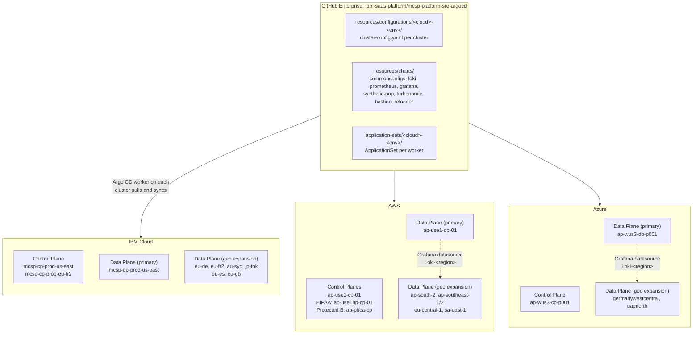

The mental model:

1. **One Git repository** is the single source of truth for what runs on every cluster.
2. **An Argo CD "worker"** runs in each cloud and region group, reads the repo, and makes the cluster match it.
3. **Control plane clusters** run a small amount of tooling; **data plane clusters** run the full toolkit for each product.
4. **Geo-expansion clusters** ("DP Lite") are small regional data planes that mostly ship their logs and let the primary data plane's Grafana read them.

---

## 4. Control Plane vs Data Plane

### 4.1 Control Plane (CP)

**[Repo]** CP clusters carry very few SRE tool entries:

| Cluster | Cloud | Tool entries | What runs |
|---|---|---|---|
| `mcsp-cp-prod-us-east` | IBM Cloud | 3 | `commonconfigs`, `loki`, `prometheus` for service line **AutoPlatform (`ap`)**. A comment in the config states: *"Grafana disabled - monitored by AWS Grafana"*. |
| `mcsp-cp-prod-eu-fr2` | IBM Cloud | 4 | Adds Grafana (with its own external database and Instana, Loki and Prometheus datasources). |
| `ap-use1-cp-01` | AWS | 4 | Full `ap` stack. Prometheus uses a service-account token (`satoken: true`), the Pushgateway is on, and the Thanos **Ruler** is on. |
| `ap-use1hp-cp-01` | AWS (HIPAA) | 4 | Same, with `compliance: HIPAA` and `privateroute: true`. |
| `ap-pbca-cp` | AWS (Protected B, Canada) | 2 | `compliance: protected B`, private routes only. |
| `ap-wus3-cp-p001` | Azure | 6 | `ap` stack. |

Two observations:

- CP clusters host **only the platform's own service line ("AutoPlatform")**, not customer-facing products.
- The CP domain always carries a **`core.`** prefix (for example `core.ibm.us-east.platform.saas.ibm.com`), whereas DP domains do not.
- Pushgateway and Thanos Ruler are enabled on the AWS CPs, which suggests that CPs host the platform's alert-rule evaluation and batch-job metric intake. **[Inferred]**

### 4.2 Data Plane (DP)

**[Repo]** DP clusters are where the product service lines live. The largest one, `mcsp-dp-prod-us-east`, has **123 tool entries across 30 service lines**; `ap-use1-dp-01` on AWS has 163 entries.

Each service line gets its own **namespace**, its own **Prometheus**, **Loki**, and **Grafana**, on a shared cluster. This isolates one product's telemetry, credentials and access groups from another's.

### 4.3 Geo-expansion DP ("DP Lite")

**[Repo]** `scripts/automation/main.sh` defines the DP Lite regions:

```
germanywestcentral uaenorth ap-southeast-1 eu-central-1 sa-east-1
eu-de au-syd jp-tok eu-es eu-gb eu-fr2 ap-south-2
```

A DP Lite cluster is a **regional data plane for data-residency and latency**. In these clusters:

- `cluster-config.yaml` carries `geoexpansion: true`, for example in `ibmcloud-prod/geoexpansion/eu-de/mcsp-dp-prod-eu-de`.
- The `commonconfigs` + `loki` pair is the standard onboarding. Prometheus and Grafana are generally *not* deployed there (the onboarding template `sretools-template-dp-lite.yaml` contains only those two tools).
- Logs stay in the region (own object-storage bucket or account). On **AWS and Azure**, Grafana in the **primary** DP is given an extra datasource per region (`Loki-<region>`) so that operators still see one pane of glass. See [section 11.3](#113-geo-expansion-logs-dp-lite).
- **IBM Cloud differs:** the `mcsp-dp-prod-us-east` configuration contains no `loki-<region>` datasources or `lokiDomain` values, so the repo does not show how IBM geo-expansion logs are viewed. See [section 16](#16-open-items-to-verify-with-the-platform-team).

---

## 5. Cluster inventory

All data below is taken from the 44 `cluster-config.yaml` files. "Tools" is the count of `- tool:` entries.

### 5.1 Production

| Cloud | Cluster ID | Role | Region | Domain | Tools |
|---|---|---|---|---|---|
| IBM Cloud | `mcsp-cp-prod-us-east` | CP | us-east | `core.ibm.us-east.platform.saas.ibm.com` | 3 |
| IBM Cloud | `mcsp-dp-prod-us-east` | DP (primary) | us-east | `ibm.us-east.platform.saas.ibm.com` | 123 |
| IBM Cloud | `mcsp-cp-prod-eu-fr2` | CP | eu-fr2 (Paris) | `ibm.eu-fr2.platform.saas.ibm.com` | 4 |
| IBM Cloud | `mcsp-dp-prod-eu-fr2` | DP Lite | eu-fr2 | `ibm.eu-fr2.platform.saas.ibm.com` | 8 |
| IBM Cloud | `mcsp-dp-prod-eu-de` | DP Lite | eu-de (Frankfurt) | `ibm.eu-de.platform.saas.ibm.com` | 31 |
| IBM Cloud | `mcsp-dp-prod-au-syd` | DP Lite | au-syd | `ibm.au-syd.platform.saas.ibm.com` | 23 |
| IBM Cloud | `mcsp-dp-prod-jp-tok` | DP Lite | jp-tok | `ibm.jp-tok.platform.saas.ibm.com` | 22 |
| IBM Cloud | `mcsp-dp-prod-eu-es`, `-eu-gb` | DP Lite (reloader only so far) | eu-es, eu-gb | n/a | stub |
| AWS | `ap-use1-cp-01` | CP | us-east-1 | `platform.saas.ibm.com` | 4 |
| AWS | `ap-use1-dp-01` | DP (primary) | us-east-1 | `platform.saas.ibm.com` | 163 |
| AWS | `ap-use1hp-cp-01` | CP, HIPAA | us-east-1 | `core.use1.private.usreg.platform.saas.ibm.com` | 4 |
| AWS | `ap-pbca-cp` | CP, Protected B | ca-central-1 | `core.cac1.private.cagov.platform.saas.ibm.com` | 2 |
| AWS | `ap-aps1-dp-01` | DP Lite | ap-southeast-1 | `aws.ap-southeast-1.platform.saas.ibm.com` | 26 |
| AWS | `ap-aps2-dp-01` | DP Lite | ap-southeast-2 | `aws.ap-southeast-2.platform.saas.ibm.com` | 12 |
| AWS | `ap-euc1-dp-01` | DP Lite | eu-central-1 | `aws.eu-central-1.platform.saas.ibm.com` | 34 |
| AWS | `ap-sae1-dp-01` | DP Lite | sa-east-1 | `aws.sa-east-1.platform.saas.ibm.com` | 6 |
| AWS | `ap-as2-dp-01` | DP Lite | ap-south-2 | `aws.ap-south-2.platform.saas.ibm.com` | 2 |
| Azure | `ap-wus3-cp-p001` | CP | westus3 | `core.azure.westus3.platform.saas.ibm.com` | 6 |
| Azure | `ap-wus3-dp-p001` | DP (primary) | westus3 | `azure.westus3.platform.saas.ibm.com` | 57 |
| Azure | `ap-gwc-dp-01` | DP Lite | germanywestcentral | `azure.germanywestcentral.platform.saas.ibm.com` | 6 |
| Azure | `ap-uaen-dp-p001` | DP Lite | uaenorth | `azure.uaenorth.platform.saas.ibm.com` | 0 (provisioned, not yet onboarded) |

### 5.2 Non-production (same pattern, smaller)

| Environment | IBM Cloud | AWS | Azure | Other |
|---|---|---|---|---|
| **dev ("build")** | `mcsp-cp-dev-us-east`, `mcsp-dp-dev-us-east`, `mcsp-cp/dp-dev-eu-de` | `ap-use1-d-cp-01`, `ap-use1-d-dp-01`, `ap-cp-001` (legacy) | `ap-cp-public001`, `ap-dp-public001`, germanywestcentral geo | Fyre (IBM internal lab): `mcsp-fyre-dev-cp`, `mcsp-fyre-dev-dp` |
| **test / stg** | `mcsp-cp-test-us-east`, `mcsp-dp-test-us-east`, `mcsp-cp/dp-test-eu-de` | `ap-use1-t-cp-01`, `ap-use1-t-dp-01` | `ap-eus-cp-101`, `ap-eus-dp-101`, `ap-gw2-dp-01` | `mcsp-aws-test-cp` |
| **CI branch tests** | | | | Fyre: `mcsp-branch` (per-PR ephemeral clusters, see [12.4](#124-pull-request-validation)) |

### 5.3 Naming convention **[Repo]**

```
mcsp-dp-prod-us-east          ap-use1-dp-01          ap-wus3-dp-p001
 │    │  │    └ region          │   │   │  └ #          │   │   │    └ #
 │    │  └ environment           │   │   └ plane (dp/cp)  │   │   └ plane
 │    └ plane (cp/dp)            │   └ region (use1=us-east-1)   │   └ region (wus3=westus3)
 └ platform                      └ "ap" = AutoPlatform           └ "ap" = AutoPlatform
```

---

## 6. How multiple clouds work together

MCSP is **cloud-agnostic by design**. There are three mechanisms that make three hyperscalers behave as one platform. All are **[Repo]**.

### 6.1 One repo, one chart set, per-cloud overlays

Every cloud uses the **same Helm charts** under `resources/charts/`. What differs is a thin layer of values selected by the `cloud` label on each cluster:

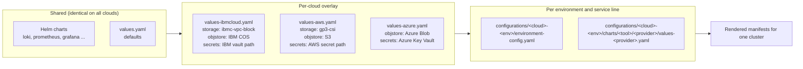

What changes between clouds **[Repo]**:

| Concern | IBM Cloud | AWS | Azure |
|---|---|---|---|
| Block storage class | `ibmc-vpc-block-10iops-tier` | `gp3-csi` | not checked |
| Log/metric object storage | IBM Cloud Object Storage (S3-compatible) | S3 | Azure Blob Storage (service principal) |
| Secret store paths (via Argo CD Vault Plugin) | `ibmcloud/kv/secrets/groups/mcsp-sretooling#…` | `mcsp-serviceline-credentials/ap#…` | `sretools-<app>-<Env>#…` |
| Grafana DB (`grafana-ini.yaml`) | `dburl` from vault, rendered as `type = postgres` | `dbhost`/`dbuser`/`dbpassword` from vault, rendered as `type = mysql` | Same `dbhost` pattern as AWS, so `type = mysql` |
| OpenShift flavour | IBM Cloud Red Hat OpenShift | ROSA (`*.openshiftapps.com` API URLs) | Azure Red Hat OpenShift **[Inferred]** |
| Mail relay (`environment-config.yaml`) | SendGrid (`smtp.sendgrid.net`) | IBM relay (`na.relay.ibm.com`) | not checked |

### 6.2 Same domain scheme everywhere

All clouds publish under `*.platform.saas.ibm.com` (`.dev.`, `.test.` for non-prod) with a **cloud/region subdomain**, plus a **`.private.`** variant for internal-only routes. This lets tools generate URLs by pattern, such as `https://loki-<service>.<cluster domain>` or `https://prometheus-<service>.<cluster domain>`.

### 6.3 Cross-cloud observability

The clouds are not islands. **[Repo]** examples:

- The IBM CP config says *"Grafana disabled - monitored by AWS Grafana"*. The AWS Grafana stack watches IBM's control-plane `ap` service line. One pane of glass, regardless of where the cluster runs.
- IBM, AWS and Azure each have a **primary DP** and **geo-expansion DPs**. On AWS and Azure the primary DP's Grafana reads the geo DPs' Loki (see [section 11.3](#113-geo-expansion-logs-dp-lite)); the IBM equivalent is not visible in this repo.
- Every cloud authenticates humans against the same IBM identity provider (**IBM Security Verify**, `sre-ibm-prod.verify.ibm.com`) and uses the same role-group naming (`MCSP_Prod_Glb_PlatformSRE_<ServiceLine>`).

### 6.4 Special compliance clouds

AWS has dedicated, separated deployments for regulated workloads, with their own configuration directories:

| Directory | Purpose |
|---|---|
| `aws-hipaa-prod` | HIPAA workloads (`compliance: HIPAA`, private routes, `usreg` domain) |
| `aws-protectedb-prod` | Canadian government "Protected B" (`cagov` domain, `ca-central-1`) |
| `fyre-*` | IBM-internal lab clusters for dev and CI only |

---

## 7. How clusters are linked

"Linking" means several different things. All four are real in this repository.

### 7.1 Management link: Argo CD manager to worker to cluster **[Repo]**

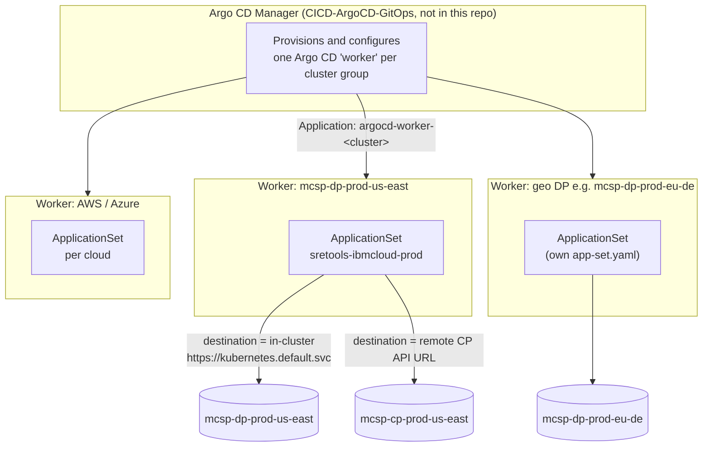

The evidence for this wiring:

- `scripts/verification/charts/control-plane/templates/argocd-application.yaml` creates an Argo CD application named `argocd-worker-<cluster>` from a manager namespace, with `argocd.instance.type=worker`, destined for `namespace: argocd-worker`.
- Each worker applies an ApplicationSet (namespace `argocd-worker`, Argo CD project `mcsp-sretooling`).
- A cluster's own `cluster.url` in its `cluster-config.yaml` decides whether Argo deploys **in-cluster** (`https://kubernetes.default.svc`, which is the case for every DP) or **remotely** (a real API URL such as `https://c109-e.private.us-east.containers.cloud.ibm.com:31402`, which is the case for IBM CP clusters). **This is how a DP-hosted worker also manages its sister CP.** For example, the `eu-fr2` configuration folder contains both `mcsp-cp-prod-eu-fr2` (remote URL) and `mcsp-dp-prod-eu-fr2` (in-cluster).

> **Note on AWS file placement.** The AWS ApplicationSet files live under `application-sets/aws-prod-private/workers/ap-use1-cp-01/`, even though the `ap-use1-dp-01` entry uses an in-cluster URL. See [section 16](#16-open-items-to-verify-with-the-platform-team).

### 7.2 Telemetry link: product cluster to SRE stack (federation) **[Repo]**

Product workloads can run in a *separate* OpenShift cluster from the SRE stack. The Prometheus chart contains the mechanism to link them:

```mermaid
sequenceDiagram
    autonumber
    participant PC as Product cluster (monitored)
    participant J as PostSync Job<br/>create-federation-secret
    participant SRE as SRE namespace sretools-&lt;svc&gt;
    participant PR as Prometheus (SRE stack)

    Note over PC: Service account prometheus-addon-sa<br/>has read access to infra metrics
    J->>PC: oc get secret prometheus-addon-sa-token
    J->>PC: oc get infrastructures.config.openshift.io cluster (API URL)
    J->>SRE: create secret "federation"<br/>{ saToken, url, configMapName, namespace }
    Note over SRE,PR: Federation secret is the hand-off.<br/>(The component that turns it into scrape jobs is outside this repo.)
    PR->>PC: GET /federate (Bearer token, HTTPS)<br/>match: kube-state-metrics, node-exporter
    PR->>PC: GET /federate on thanos / user-workload route
    PC-->>PR: metrics labelled with team, clusterName, region
```

The job template (`prometheus-job-template.yaml`) shows exactly what is scraped: kube-state-metrics and node-exporter series from the cluster's Prometheus, plus user-workload metrics via the Thanos route, tagged with `team`, `clusterName` and `region`. High-cardinality series (`kubelet_*`, `etcd.*bucket`, `kube_secret.*` etc.) are dropped before storage.

### 7.3 Log link: DP Lite to primary DP Grafana **[Repo]**

A geo-expansion cluster is "linked" to its primary DP by **datasource registration**, with no network peering. See [section 11.3](#113-geo-expansion-logs-dp-lite).

### 7.4 Access link: Teleport bastion **[Repo]**

Each DP and geo DP has a `teleport-cluster-config.yaml` and `app-set-teleport.yaml` that deploys `resources/charts/bastion`. The bastion provides identity-aware, audited admin access (via OIDC with IBM Verify) to clusters on all three clouds. The README for the chart documents the cloud-specific back-ends: S3 + DynamoDB on AWS, PostgreSQL + a storage account on Azure.

---

## 8. The service lines (products) running on MCSP

**[Repo]** Each "service line" is onboarded with a short code (`provider`) and gets an isolated namespace and tool stack. The primary IBM data plane (`mcsp-dp-prod-us-east`) currently hosts these 30:

| Code | Service line (as configured) | Code | Service line (as configured) |
|---|---|---|---|
| `acc` | wxo-concierge | `ini` | ikigai |
| `cp4ba` | cp4ba | `instana` | instana |
| `cwf` | concertworkflows | `isv` | isv |
| `dai` | dai | `match` | match360 |
| `dalh` | wxdata | `mq` | mq |
| `daop` | openpages | `neo4` | neo4j |
| `dapa` | planninganalytics | `roja` | roja |
| `db2c` | db2oc | `scaas` | scaas |
| `decision` | decision | `sset` | di_streamsets |
| `di` | ikc | `uab` | uab |
| `drep` | drep | `wgov` | wxgov |
| `ds` | ds | `wo` / `wxo` | Watson_Orchestrate |
| `dtbd` | databand | `wrun` | wxruntime |
| `wxai` | wxai | `wxbi` | wxbia |
| `wxca` | wxca | `wxsk` | wxspark |

The platform's own service line is **`ap` = AutoPlatform**, which is the only one on CP clusters. AWS also has `ads` = ADS, and others that appear under `resources/configurations/aws-*/charts/`.

---

## 9. How a service line or "adapter" uses MCSP

### 9.1 A note on the word "adapter"

The word *adapter* **does not appear anywhere in this repository**. Based on how the repo links external clusters (see [7.2](#72-telemetry-link-product-cluster-to-sre-stack-federation-repo)), the interpretation used in this document is:

> **"Adapter cluster" = a product/service-line cluster (or product workload) that plugs into MCSP and is monitored, logged and operated through the MCSP SRE stack.** **[Inferred]**

If "adapter" means something else on your team (for example a product-side integration layer for entitlement or provisioning), the telemetry sections here still apply, but the business-integration part belongs to a repository that is not visible here. Please confirm.

### 9.2 What a product team does to join MCSP

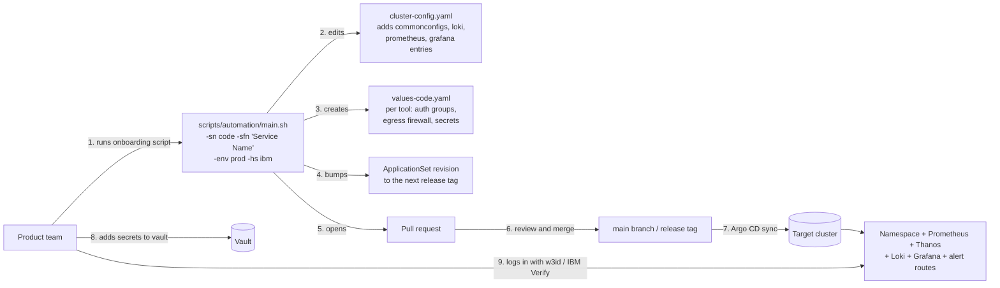

Key facts **[Repo]** (`scripts/automation/readme.md`, `main.sh`, `update-sretools.sh`):

- Flags: `-env` is one of `build|test|preprod|prod`; `-hs` picks the hyperscaler (`ibm`, `aws`, `azure`, `govcloud`); `-ar <region>` triggers **geo-expansion** (DP Lite) onboarding instead of primary-region onboarding.
- A `-deboard` flag reverses all of the above. After merge, an operator must also sync the Argo CD app and delete the namespace.
- The script reads `environment-<cloud>.yaml` to know which workers exist per environment, and generates the relevant files for each.
- For DP Lite onboarding it also injects the `loki-<region>` datasource into the primary worker's Grafana configuration, and adds the regional Loki domain and storage endpoint to the product's **egress firewall** allow-list.

### 9.3 What the product team gets once onboarded

| They get | Where | How they use it |
|---|---|---|
| Namespace `sretools-<code>` | DP cluster | Isolated home for their SRE tools |
| Prometheus + Thanos | `https://prometheus-<code>.<cluster domain>` and `https://thanos-querier-<code>.<cluster domain>` | Query metrics; 14-day local retention with long-term storage in object storage |
| Alertmanager | `alertmanager-<code>.<cluster domain>` | Route alerts |
| Loki | `https://loki-<code>.<cluster domain>` | Log search; agents (Promtail/Vector) push to it with per-product credentials |
| Grafana | per service line | Dashboards with Prometheus, Thanos, Loki and Instana datasources, SSO via IBM Verify |
| Network and egress policy | `commonconfigs` chart | Default same-namespace-only ingress and an egress firewall allow-list |
| Optional | `synthetic-pop` (Instana), `turbonomic`, `bastion` (Teleport) | Synthetic probes, capacity advice, secure shell access |

---

## 10. The SRE tooling stack, per service line

Everything in one cluster, for one service line `<code>`:

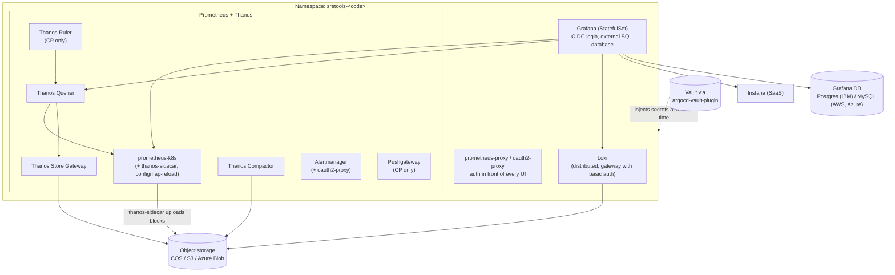

| Chart | Version pin **[Repo]** | Notes |
|---|---|---|
| `prometheus` (wraps community chart + Thanos from Bitnami + alertmanager) | Prometheus chart 29.36.1, Thanos 17.3.1, Alertmanager 2.1.0, Thanos image v0.42.4 | 14-day local retention (`--storage.tsdb.retention.time=14d`), Thanos sidecar uploads to object storage |
| `loki` | per `Chart.yaml` | Distributed mode, gateway with basic auth, ingress public and private, S3/COS/Azure Blob backend |
| `grafana` | per `Chart.yaml` | StatefulSet, OIDC, datasources generated from `cluster-config.yaml` |
| `commonconfigs` | 0.1.0 | Namespace-level network policy, egress firewall, pull secret, kubeturbo secret |
| `synthetic-pop` | 1.2.58 | Instana Synthetic PoP controller |
| `turbonomic` | see README | Capacity optimisation, manual first-login setup |
| `bastion` | Teleport | Admin access |
| `reloader` | Stakater chart 2.2.17 | Rolling restarts on ConfigMap or Secret change |

Source for versions: `resources/charts/*/Chart.yaml` and the README table. Check the charts for current values, since they are bumped regularly.

---

## 11. Telemetry data flows

### 11.1 Metrics

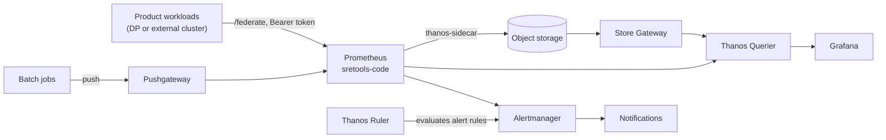

### 11.2 Logs

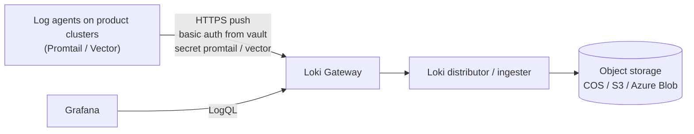

The per-product credentials come from the vault (for example `ibmcloud/kv/secrets/groups/mcsp-sretooling#loki-<code>`) and are templated into both the agent-side secret and the gateway's `.htpasswd`.

### 11.3 Geo-expansion logs (DP Lite)

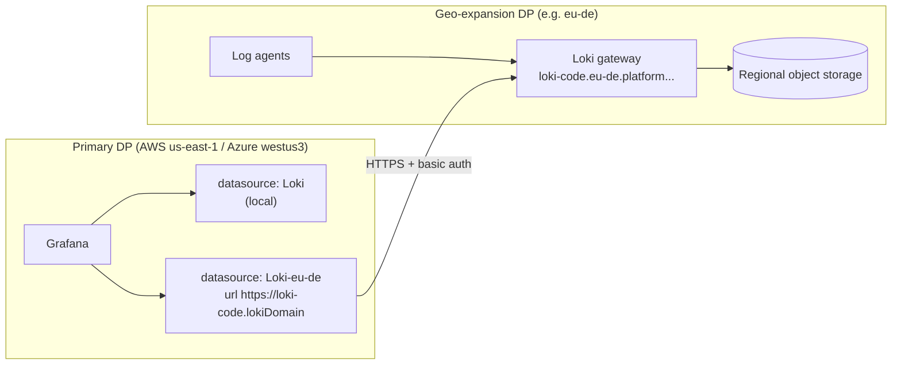

The Grafana template `ds-loki-geoexpansion.yaml` loops over datasource keys that start with `loki-` and renders one Grafana datasource per region from the `lokiDomain` value. Log agent secrets are **not** created in geo-expansion clusters (`{{- if not .Values.geoexpansion }}` guards `vector-secret.yaml` and `provider-secret.yaml`); the regional Loki is configured with a region-specific bucket and credentials instead.

---

## 12. GitOps: how everything gets deployed

### 12.1 Repository layout **[Repo]**

```
mcsp-platform-sre-argocd/
├── application-sets/
│   └── <cloud>-<env>/                 e.g. ibmcloud-prod, aws-prod-private, azure-prod
│       ├── workers/<cluster>/         app-set.yaml, reloader-app-set.yaml, teleport app-set
│       └── geoexpansion/<region>/<cluster>/
├── resources/
│   ├── charts/                        loki, prometheus, grafana, commonconfigs, ...
│   └── configurations/<cloud>-<env>/
│       ├── environment-config.yaml    one per environment (storage class, OIDC, vault paths)
│       ├── workers/<cluster>/cluster-config.yaml
│       ├── geoexpansion/<region>/<cluster>/cluster-config.yaml
│       └── charts/<tool>/<code>/values-<code>.yaml     per service-line overrides
├── scripts/automation/                onboarding / deboarding
├── scripts/verification/              lint and end-to-end test harness
└── .tekton/                           PR scan pipeline
```

### 12.2 From a YAML line to a running pod

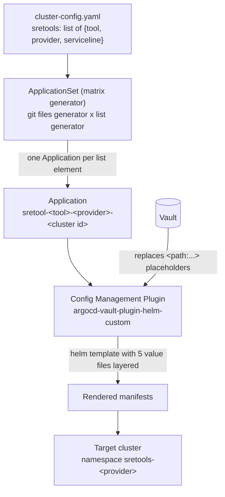

The `HELM_VALUES` layering (from `app-set.yaml`) is, in order, the most important thing to understand when debugging:

1. `values.yaml`: chart defaults
2. `values-<cloud>.yaml`: cloud overlay
3. `configurations/<cloud>-<env>/environment-config.yaml`: environment (storage class, OIDC endpoints, vault paths)
4. the matched `cluster-config.yaml` entry (the `tool` entry, `serviceline`, `datasources`, `mysql`, etc.)
5. `configurations/<cloud>-<env>/charts/<tool>/<provider>/values-<provider>.yaml`: per-service-line overrides

Some service lines additionally layer a values file from the worker folder, such as `prometheus/db2c`, `dalh`, `cwf`, `daop` and `mq` on IBM prod. Those are the ones that need proxy-port tweaks and TCP-socket probes.

One Application per `(tool × provider × cluster)` means that **123 tool entries on `mcsp-dp-prod-us-east` become 123 Argo CD Applications**.

### 12.3 Releases and revision pinning

- Releases are cut with `semantic-release` (`.releaserc`, branches `main` and `alpha`), which produces tags like `v1.101.10`.
- **Production** ApplicationSets are **pinned to a release tag** in two places: `.spec.generators[…].git.revision` and `.spec.template.spec.source.targetRevision`. The onboarding script `update-application-sets.sh` bumps both to the next patch version.
- **Dev/test** ApplicationSets and non-IBM stg/dev CPs typically follow `main`.

### 12.4 Pull request validation

Two layers **[Repo]**:

1. **Lint and scan:** `scripts/verification/lint.sh` (yamllint, helm lint) and the Tekton `scan-pipeline` (`.tekton/03_pipeline.yaml`) which runs on PR events.
2. **End-to-end test on a throw-away cluster:** `scripts/verification/validate-branch-e2e.sh` logs in to the Fyre control plane, creates a `CloudRockCluster` named `mcsp-pr-<N>`, installs an Argo CD worker, applies a temporary ApplicationSet that points to the PR branch, and waits for the Applications to become healthy. `delete-e2e-env.sh` tears it down.

> This is concrete evidence of the CP/DP concept: the CP creates and configures clusters on request.

---

## 13. Security and access

| Concern | Mechanism **[Repo]** |
|---|---|
| Human login (Grafana, Prometheus, Thanos, Alertmanager) | OIDC against **IBM Security Verify** (`sre-ibm-prod.verify.ibm.com`), enforced by an `oauth2-proxy` sidecar or `prometheus-proxy` in front of each UI |
| Authorisation | `allowedgroups` per service line in `cluster-config.yaml`, for example `MCSP_Prod_Glb_PlatformSRE_AutoPlatform` and `MCSP_Prod_Glb_PlatformDeveloper_AutoPlatform` |
| Machine access | HTTP basic auth (bcrypt `.htpasswd`) between Grafana and Prometheus/Loki, and between log agents and Loki |
| Secrets | **No secrets in Git.** Values use `<path:…>` placeholders; the `argocd-vault-plugin-helm-custom` plugin resolves them at render time using the `argocd-prod-mcsp-credentials` secret. The repo uses `detect-secrets` (`.secrets.baseline`) to block accidental commits. |
| Network | Default NetworkPolicy allows only same-namespace and OpenShift ingress; `egressFirewallRules` per service line control outbound destinations (storage, Loki, DNS names). |
| TLS | `cert-manager` `ClusterIssuer` (`letsencrypt`) plus OpenShift service-serving certs; routes use `reencrypt`. |
| Public vs private routes | Each tool gets a public Ingress and a `.private.` Ingress (`scope-public` / `scope-private` labels). Compliance clouds (HIPAA, Protected B) set `privateroute: true` and only expose private routes. |
| Hardened containers | `readOnlyRootFilesystem`, `drop: ALL` capabilities, non-root, `RuntimeDefault` seccomp on the jobs and sidecars. |
| Admin shell access | Teleport bastion with OIDC and audited sessions. |
| Image supply | All images pulled from the IBM Container Registry mirror `icr.io/ibm-saas-platform/external-images/…` using an image-pull secret. |

---

## 14. Environments and promotion

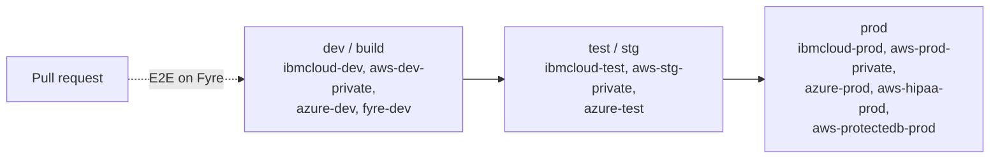

- The onboarding tool maps `build` to the `*-dev*` directories, `test` to `*-test*` / `*-stg*`, and `prod` to the production directories.
- A change is typically merged to `main` and validated on dev and test first; production ApplicationSets are then repointed to the new release tag.

---

## 15. How to explain MCSP to a newcomer

### 15.1 The 30-second version

> MCSP is IBM's shared platform for running its SaaS products on IBM Cloud, AWS and Azure. Think of it as a **city**: a few **city-hall clusters** (control planes) manage the platform, and many **neighbourhood clusters** (data planes) host the actual products. A **GitOps repository** is the city plan: every pipe, wire and sensor (monitoring, logging, dashboards) is described in Git, and robots (Argo CD) keep every neighbourhood matching the plan.

### 15.2 The 5-minute version, using the analogy

| Analogy | Real thing |
|---|---|
| City plan stored in the planning office | Git repo `mcsp-platform-sre-argocd` |
| City hall | Control Plane cluster (`…cp…`, `core.` domain) |
| Neighbourhood | Data Plane cluster (`…dp…`) |
| Small satellite town for legal or latency reasons | Geo-expansion "DP Lite" cluster (EU, Japan, Australia, Brazil, India, UAE) |
| Shop in the neighbourhood | A product / service line (watsonx, MQ, Db2 ...) |
| Utility meters on every shop | Prometheus (metrics), Loki (logs), Grafana (dashboards), Alertmanager |
| Robots that keep everything matching the plan | Argo CD workers |
| Key safe | Vault (secrets are never in the plan) |
| Security guard with an access log | Teleport bastion |
| Three countries with different building codes but one plan | IBM Cloud, AWS, Azure with per-cloud overlays |

### 15.3 Suggested whiteboard order

1. Draw **three clouds**.
2. In each, draw **one CP and one primary DP**.
3. Add **small DP Lite boxes** for other regions.
4. Draw **Git → Argo CD → clusters** as one arrow from the top.
5. Inside a DP, draw **service-line namespaces**, and inside one of them the **Prometheus, Loki and Grafana** trio.
6. Finish with the **onboarding PR**: "a new product joins by adding a few lines of YAML".

---

## 16. Open items to verify with the platform team

These are the places where the repo is silent, ambiguous or inconsistent. Resolve them before sharing this document outside the SRE team.

| # | Question | Why it matters |
|---|---|---|
| 1 | What does **"adapter"** mean in your context? | The word does not occur in the repo; [section 9](#9-how-a-service-line-or-adapter-uses-mcsp) assumes "product/service-line cluster plugged into MCSP". |
| 2 | Business definition of the MCSP end product, and the list of customer-facing services it provides | The repo only covers the SRE layer, so [section 2](#2-what-mcsp-delivers-the-end-product) uses general context. |
| 3 | What consumes the `federation` secret created by `create-federation-secret`? | The consumer is not in this repo; it is the other half of the product-cluster link. |
| 4 | On AWS the main ApplicationSet lives under `…/ap-use1-cp-01/`, yet `ap-use1-dp-01` uses an in-cluster URL. Which Argo instance actually deploys the DP? | The IBM layout is clear; the AWS one needs confirmation. |
| 5 | Where is the Argo CD **manager** configured, and how many managers exist per cloud? | It is in `CICD-ArgoCD-GitOps` (not read). |
| 6 | Role of the CP's Thanos Ruler and Pushgateway (enabled only on AWS CPs) | Inferred as central alert-rule evaluation and batch metric intake. |
| 7 | IBM `eu-es` and `eu-gb` DP Lite clusters: planned or live? | Only `reloader-cluster-config.yaml` exists. |
| 8 | `ap-uaen-dp-p001` has 0 tool entries | Provisioned but not onboarded. |
| 9 | Contents of the sibling repos (Teleport image, Teleport AWS IaC, `cp-addon-teleport`, `sre-tooling-upgrade-automation`) | Read only by name; they may add detail on bastion and upgrade automation. |
| 10 | Full MCSP architecture documents: CI/CD Playbook (`pages.github.ibm.com/ibm-saas-platform/CICD-Playbook`) and Platform SRE Runbook (`…/platform-sre-runbook`) | Linked from this repo's docs; not reachable from here. |
| 11 | How are IBM Cloud geo-expansion Loki instances viewed in Grafana? | AWS and Azure primary DPs define `loki-<region>` datasources with `lokiDomain`; the IBM primary DP does not. |

To close items 1, 2, 5 and 10, share the other MCSP repos or documentation with the workspace and this document can be extended.

---

## 17. Glossary

| Term | Meaning |
|---|---|
| **MCSP** | Multicloud SaaS Platform |
| **CP** | Control Plane cluster |
| **DP** | Data Plane cluster |
| **DP Lite / geo-expansion** | Smaller regional DP, typically logs only, in a separate region for data residency |
| **Service line** | A product or team onboarded to MCSP; has a short **provider** code (`wxo`, `mq`, `db2c`, ...) |
| **AutoPlatform (`ap`)** | The platform's own service line, present on every CP |
| **Worker (Argo CD)** | The Argo CD instance in `argocd-worker` that applies ApplicationSets to its clusters |
| **ApplicationSet** | Argo CD object that generates many Applications from a template and a generator |
| **AVP** | Argo CD Vault Plugin; replaces `<path:…>` placeholders with secrets at render time |
| **Thanos** | Long-term, highly available Prometheus storage and query layer |
| **Loki** | Log aggregation system (like Prometheus, but for logs) |
| **Promtail / Vector** | Log shippers that push to Loki |
| **Instana** | IBM application performance monitoring (SaaS); Grafana reads it as a datasource |
| **Turbonomic / kubeturbo** | Resource optimisation; kubeturbo is the in-cluster probe |
| **Teleport / bastion** | Identity-aware access proxy for admin shell and Kubernetes access |
| **Reloader** | Controller that restarts workloads when their ConfigMaps or Secrets change |
| **ROSA / ARO** | Red Hat OpenShift on AWS / Azure |
| **Fyre** | IBM internal lab cloud used for dev and CI |
| **HIPAA / Protected B** | Compliance regimes with dedicated AWS deployments (US healthcare, Canadian government) |
